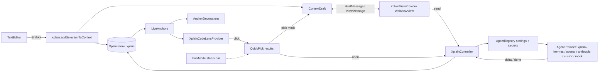

# Архитектура

## Обзор



Расширение состоит из двух процессов:

- **Extension host** (`src/`, Node.js, бандл `dist/extension.js`) — вся логика, доступ к файлам и API VS Code.
- **Webview** (`webview/`, браузер, бандл `dist/webview.js`) — UI панели на Preact. Не имеет доступа ни к
  файлам, ни к API VS Code; общается с хостом только сообщениями.

## Модули extension host

| Модуль | Ответственность |
| --- | --- |
| `extension.ts` | Активация: создание `XplainStore` для первого workspace-фолдера, регистрация view/CodeLens/декораций, watcher `.xplain`, сборка `XplainController` |
| `XplainController.ts` | Оркестрация: команды, обработка `ViewMessage`, добавление выделения, отправка агенту, открытие результатов, QuickPick, шаблоны, фон |
| `context/ContextDraft.ts` | Состояние неотправленного контекста (items, question, templateId), дедупликация, события изменений |
| `storage/XplainStore.ts` | Персистентность `.xplain/`: индекс, якоря (`upsertAnchor`), сессии, результаты, шаблоны, фон. Работает поверх абстракции `StoreFs` |
| `storage/fs.ts`, `storage/vscodeFs.ts` | `StoreFs` (relative POSIX-пути): `NodeStoreFs` для тестов, `VscodeStoreFs` поверх `workspace.fs` (работает и при Remote) |
| `editor/anchors.ts` | Чистые функции: нормализация/хеш блока, `toLineChange`, `applyLineChange(s)`, `findSnippet`, `rangeMatchesHash` |
| `editor/LiveAnchors.ts` | Актуальные диапазоны якорей для открытых документов: применяет `onDidChangeTextDocument`, валидирует по хешу, переищет по snippet, отложенно сохраняет в store |
| `editor/XplainCodeLensProvider.ts` | CodeLens над каждым нестареющим якорем с ≥ 1 готовой сессией |
| `editor/decorations.ts` | Gutter-иконка, подсветка, hover с command-ссылками; подсветка блоков текущего контекста |
| `editor/pickMode.ts` | Флаг pick mode, status bar item, контекстный ключ `xplain.pickMode`, автовыключение |
| `agent/AgentProvider.ts` | Интерфейс `AgentProvider`, типы `AgentRequest/AgentItem/AgentResponse`, `AgentError` |
| `agent/AgentRegistry.ts` | Чтение/запись `xplain.agent.*` (`read/view/save`, цель global/workspace, дефолты не записываются), ключи в `SecretStorage` по провайдеру, фабрика провайдера, подпись для футера, `listModels()` (`GET /models` для чат-провайдеров), `test()` (список моделей / ping) |
| `agent/stream.ts` | Общие примитивы: `fetchWithTimeout` (idle-таймаут, сброс на каждом чанке тела), `withActivityBump`, `readLines` (NDJSON), `readSse` (SSE), `joinUrl` |
| `agent/prompt.ts` | `buildChatPrompt`: язык + (опц.) диаграммы + шаблон → результаты → Scope/Focus blocks + Full files (context) → вопрос; `DEFAULT_SYSTEM_PROMPT`, `detectHtml` |
| `skills/excalidrawInstructions.ts` | Текст инструкций для агента (без `vscode`) |
| `skills/skillStore.ts` | Durable store `.xplain/skills/<id>/` + runtime bridge под агента (`.cursor/` / `.claude/`) |
| `skills/excalidraw.ts` | Обёртка Excalidraw: `prepareExcalidrawSkillForProvider(provider)` |
| `agent/HttpAgentProvider.ts` | Провайдер `xplain`: `fetch` к endpoint, JSON / NDJSON / SSE по контракту XPlain |
| `agent/hermesHints.ts` | Распознавание типичной ошибки: Base URL указывает на Hermes dashboard, а не на API-сервер (`GET /api/status` → `gateway_platforms.api_server.listener_base`), текст подсказки с нужным адресом/портом |
| `agent/OpenAIChatProvider.ts` | Провайдеры `hermes` и `openai`: Chat Completions, SSE-чанки, пропуск сторонних событий (`hermes.tool.progress`), `listOpenAIModels` |
| `agent/AnthropicProvider.ts` | Провайдер `anthropic`: Messages API, `content_block_delta`/`text_delta`, `listAnthropicModels` |
| `agent/MockAgentProvider.ts` | Офлайн-ответ со стримингом для демо и smoke-тестов |
| `agent/htmlResult.ts` | Нормализация ответа в self-contained `result.html` (HTML / фрагмент / Markdown→HTML) |
| `agent/inlineAssets.ts` | Встраивание локальных `` / `url(...)` в `data:` URI при сохранении и открытии |
| `agent/titles.ts` | `deriveTitle`: агент → заголовок md/html → вопрос → файл+диапазон; обрезка до 72 символов |
| `panel/XplainViewProvider.ts` | `WebviewViewProvider`: HTML-оболочка, CSP с nonce, `localResourceRoots`, очередь сообщений до resolve |
| `panel/background.ts` | Выбор/сохранение/очистка фона (user scope в `globalStorageUri`, workspace scope в `.xplain/ui/`), состояние для webview |
| `shared/types.ts`, `shared/protocol.ts` | Общие типы данных и протокол сообщений (используются и хостом, и webview через алиас `@shared/*`) |
| `util/emitter.ts`, `util/ids.ts` | Мини-эмиттер без зависимости от `vscode`, генерация id, sha1 |

Зависимости направлены «внутрь»: `storage`, `context`, `agent`, `editor/anchors`, `shared`, `util` не
импортируют `vscode` (кроме `vscodeFs` и `agent/AgentRegistry`) и покрываются unit-тестами в Node. Всё, что трогает VS Code,
сосредоточено в `extension.ts`, `XplainController.ts`, `editor/*` (кроме `anchors.ts`) и `panel/*`.

## Webview

```
webview/
  main.tsx            точка входа, render(<App/>)
  App.tsx             состояние панели, приём HostMessage, вкладки, drag-and-drop, Shift+X, фон
  vscode.ts           обёртка acquireVsCodeApi: post(), onHostMessage(), persist()/getPersisted()
  markdown.ts         markdown-it (html:false, linkify) + highlight.js (common + cuda/cpp)
  components/
    ContextTab.tsx    список элементов, шаблон, язык ответа, чекбокс Excalidraw, вопрос (debounce 250 мс), Send/Cancel
    ResultTab.tsx     рендер Markdown / Shadow DOM для HTML / потоковый вывод / переименование
    TemplatesTab.tsx  редактор шаблона (имя, инструкция, файлы, drop-zone), список шаблонов
    HistoryTab.tsx    список сессий с фильтром
    AgentTab.tsx      форма провайдера: выбор, поля, выпадающий список моделей (автозагрузка с сервера, ручной ввод как запасной вариант), ключ API, Advanced, Save (global/workspace), Test connection
  styles.css          стили на CSS-переменных темы VS Code
```

Состояние UI (активная вкладка, черновик редактируемого шаблона) сохраняется через `setState` webview и
переживает скрытие панели; `retainContextWhenHidden: true` сохраняет и DOM (важно для стриминга).

## Протокол extension ↔ webview

Определён в `src/shared/protocol.ts` как discriminated unions.

**Host → Webview (`HostMessage`)**: `init` (полное состояние), `draft`, `sessions`, `templates`, `pickMode`,
`busy`, `background`, `agentLabel`, `agentSettings` (`AgentSettingsView`: настройки + `hasKey` по провайдерам +
`target`), `agentTest`, `agentModels` (список моделей с `requestId`, `provider`, `baseUrl`, `error?`), `showResult`, `streamStart` / `streamDelta` / `streamEnd`, `templateFiles`,
`editTemplate`, `tab`, `notice`.

**Webview → Host (`ViewMessage`)**: `ready`, `setQuestion`, `setTemplate`, `removeItem`, `moveItem`,
`clearDraft`, `send`, `cancel`, `openSession`, `openSessionInEditor`, `addSessionToDraft`, `deleteSession`,
`renameSession`, `revealAnchor`, `togglePickMode`, `saveTemplate`, `deleteTemplate`, `loadTemplateForEdit`,
`pickTemplateFiles`, `readUris`, `chooseBackground`, `clearBackground`, `dropBackground`, `openSettings`,
`saveAgentSettings` (settings + target), `setAgentKey`, `clearAgentKey`, `testAgent`, `listModels` (settings + requestId), `setExplainLanguage`, `setUseExcalidraw`, `openExternal`, `log`.

Принцип: источник истины — хост. Webview отправляет намерение, хост меняет состояние и рассылает
обновление (`draft`, `sessions`, …). Исключение — локальный текст вопроса (debounce), черновик шаблона и
форма вкладки Agent (локальные правки до нажатия Save; хост присылает `agentSettings` после сохранения и
при любом изменении `xplain.agent.*` в настройках). Сам ключ API в webview никогда не возвращается —
только флаг `hasKey`.

## Ключевые потоки

### Shift+X → контекст

1. Keybinding `shift+x` (`editorTextFocus && editorHasSelection`) → `xplain.addSelectionToContext`.
2. Для каждого выделения: расширение до целых строк → `store.upsertAnchor` (поиск/создание якоря) →
   `draft.add({kind:'code', …})`.
3. `draft.onDidChange` → `view.post({type:'draft'})`; декорации подсвечивают блок; панель открывается с
   `preserveFocus`.

### Отправка

1. `send` → проверка, что нет активного запроса → `store.createSession` (status `pending`, предварительный заголовок).
2. Формирование `AgentItem[]`: для блоков — свежий текст фокус-диапазона и полный `fileText` файла
   (кэш по пути; пропуск если файл > 512 КБ); для результатов — `result.*`; для шаблона — инструкция + файлы.
3. `AgentRegistry.read()` → `AgentRegistry.provider(settings)` строит провайдера по `xplain.agent.provider`;
   `provider.explain(request, {signal, onDelta})` под `window.withProgress`; дельты транслируются в webview.
   Для чат-провайдеров `buildChatPrompt` собирает system+user: фокус-блоки отдельно, полные файлы как context only.
4. Успех → `deriveTitle` → `store.completeSession` → `draft.clear()` → `openResult`.
   Отмена → `deleteSession`. Ошибка → `failSession`, контекст сохраняется.

### Результаты в редакторе

1. `LiveAnchors.forDocument(doc)` строит актуальные диапазоны (валидация по хешу / поиск по snippet).
2. `XplainCodeLensProvider` создаёт CodeLens с командой `xplain.showResults(anchorId)` для якорей с готовыми сессиями.
3. `showResultsForAnchor` → `createQuickPick` с кнопками (`QuickInputButton`). В pick mode выбор добавляет
   результат в draft и выключает режим; иначе открывает результат в панели.
4. HTML-результат передаётся в webview целиком (`content`) и рендерится в Shadow DOM панели Result
   (не iframe): иначе Electron/VS Code часто блокирует `data:`-изображения во вложенном srcdoc.

## Используемые API VS Code (все стабильные)

`contributes.viewsContainers/views/commands/menus/keybindings/configuration`, `WebviewViewProvider`,
`Webview.asWebviewUri/cspSource/postMessage`, `languages.registerCodeLensProvider`,
`window.createTextEditorDecorationType`, `MarkdownString.isTrusted` + `command:`-ссылки,
`window.createQuickPick` + `QuickInputButton`, `window.createStatusBarItem`, `workspace.fs`,
`workspace.createFileSystemWatcher`, `workspace.onDidChangeTextDocument`, `ExtensionContext.secrets`,
`globalState`, `globalStorageUri`, `window.withProgress`, `commands.executeCommand('setContext')`,
контекстные ключи `editorTextFocus`, `editorHasSelection`, `inputFocus`, `focusedView`.

Proposed API не используются. Нижняя граница совместимости — `engines.vscode ^1.85`.

## Безопасность

- CSP webview: `default-src 'none'`, скрипты только с nonce, стили/шрифты/картинки из `cspSource`
  (+ `https:`/`data:` для картинок), фреймы только из `cspSource`.
- Markdown агента рендерится без raw HTML; HTML агента — в Shadow DOM панели Result (без nested iframe).
- Файлы шаблонов: ограничение 1 МБ, бинарные отбрасываются, имена санитизируются.
- Ключ API — только в `SecretStorage`.
