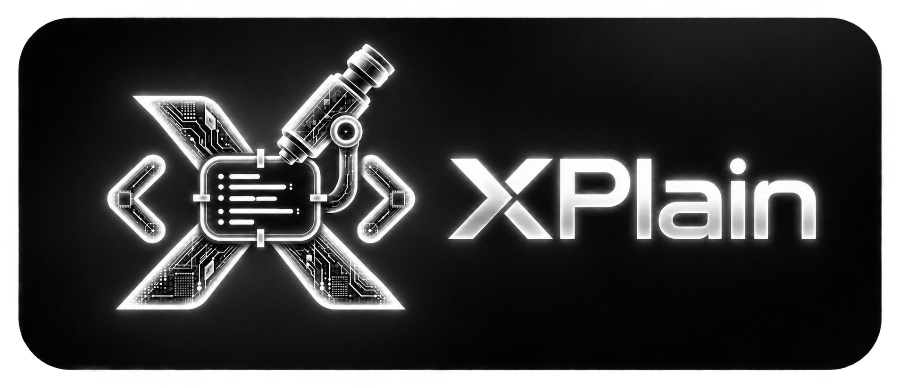

# Документация XPlain

XPlain — расширение VS Code / Cursor для объяснения кода с помощью LLM-агента. Пользователь собирает
блоки кода в контекст, добавляет вопрос и шаблон, подтверждает отправку, а ответ агента сохраняется в
проекте и привязывается к коду через CodeLens. Агент выбирается во вкладке **Agent** панели: Hermes Agent,
Anthropic (Claude), OpenAI / Codex, собственный сервис по контракту XPlain или офлайн-mock.

| Документ | Для кого | Содержание |
| --- | --- | --- |
| [01-installation.md](01-installation.md) | пользователь | Установка из `.vsix` и из исходников, Remote-SSH, скрипты автоустановки, первичная настройка агента |
| [02-user-guide.md](02-user-guide.md) | пользователь | Рабочий процесс: контекст, отправка, результаты, pick mode, шаблоны, вкладка Agent |
| [03-configuration.md](03-configuration.md) | пользователь | Настройки (`xplain.agent.*` по провайдерам), команды, горячие клавиши, секреты |
| [04-agent-api.md](04-agent-api.md) | разработчик агента / интегратор | Провайдеры (Hermes, OpenAI, Anthropic): протоколы и промпт; HTTP-контракт XPlain: запрос, JSON- и NDJSON-ответ, ошибки, Test connection |
| [05-storage.md](05-storage.md) | пользователь / разработчик | Формат папки `.xplain/`, якоря, сессии, шаблоны |
| [06-architecture.md](06-architecture.md) | разработчик расширения | Модули, потоки данных, протокол extension ↔ webview, используемые API |
| [07-development.md](07-development.md) | разработчик расширения | Сборка, тесты, отладка (F5), выпуск `.vsix` |
| [08-troubleshooting.md](08-troubleshooting.md) | все | Типичные проблемы и их решение |

Краткое описание проекта и контракта на английском — в корневом [README.md](../README.md).
